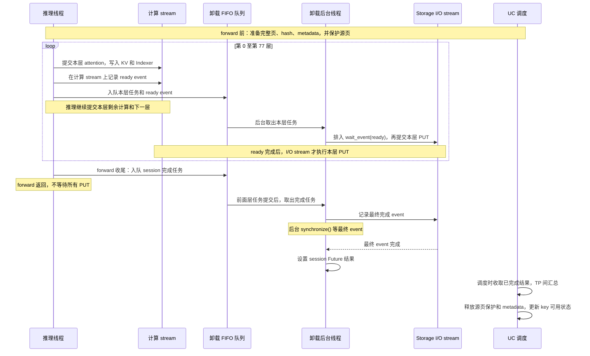
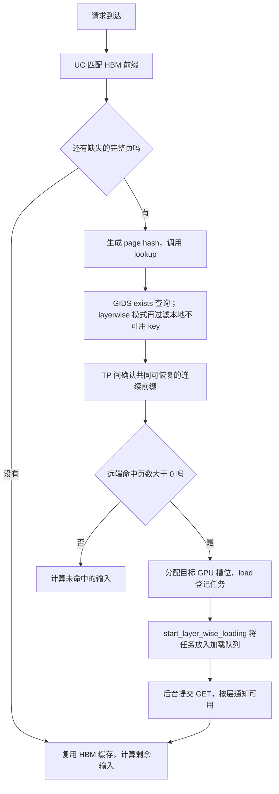
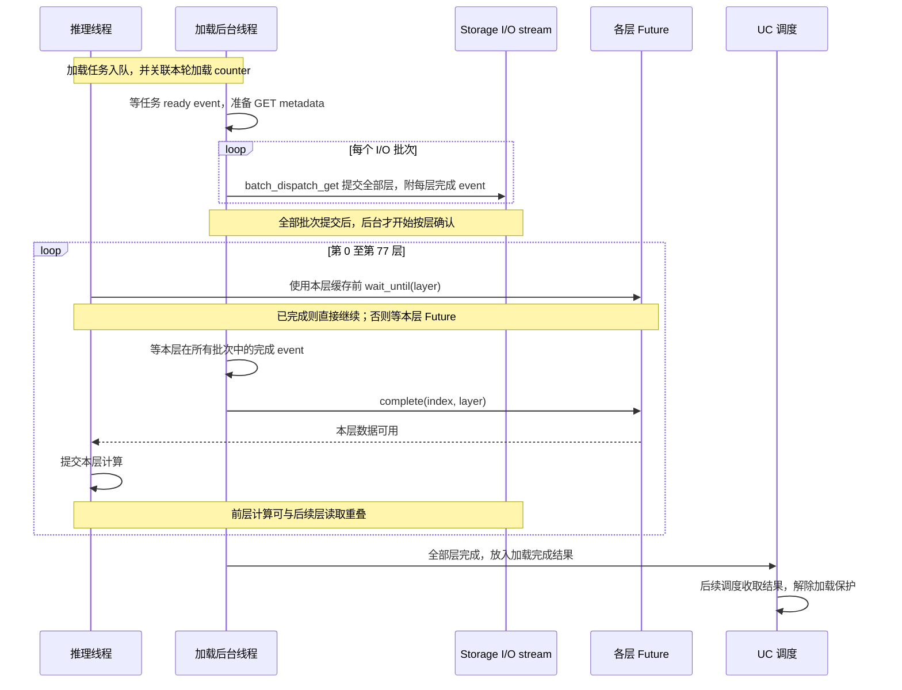

# OceanDisk layerwise 写出与 GET 流程

按当前工作区实现整理，适用于目前 GLM DSA、TP8 的运行方式。

## 1. 数据与执行位置

- 一个逻辑 page 包含同一段 token 在各层的 KV＋Indexer；当前每页 64 token、共 78 层。
- 同一页的 KV 和 Indexer 使用同一个 page hash，转换成同一个 OceanDisk key；底层通过不同 namespace 区分两种数据。
- 每层 I/O metadata 按 KV 在前、Indexer 在后排列，包含 MR、key、GPU 偏移、存储偏移、长度及连接编号。
- 当前配置中 TP0 实际 PUT，其余 rank 参与状态确认；GET 由各 rank 读取到各自 GPU。
- 每个 Linker 有卸载后台线程和加载后台线程；Storage 使用一个独立 CUDA stream，并通过共享锁串行访问。

## 2. Layerwise PUT：计算一层，提交一层

### forward 前

`UnifiedCacheLinkerWrapper.prepare_layerwise_save()`：

1. 找出本轮新形成、尚未逐层提交的完整页；不足一页的尾部暂不保存。
2. Prefill 复用 `req.get_fill_ids()` 的 CPU token；decode 读取真实 GPU 输入 token，避免使用尚未更新的采样结果。
3. 计算 page hash，取得对应 GPU 槽位。TP0 通过 assembler 展开 KV＋Indexer 的各层地址。
4. 创建 `LayerwiseSaveSession`，准备 I/O metadata，并保护源页，防止 PUT 完成前被回收复用。

当前 metadata 仍逐层创建并传到 GPU，尚未合并优化。

### 每层 attention 后

模型 hook 调用 `session.save_layer(layer)`。同层 KV 和 Indexer 写入已排入计算 stream，然后记录 ready event。

图中的 ready event 在计算 stream 执行到对应位置时才完成。CPU 记录 event、任务入队并不表示 GPU 已算完。
队列中的提交和 GPU 执行可与后续计算重叠；图中的箭头不表示推理线程等待后台。

`Storage.submit_put_layer()` 使用 `self._stream.wait_event(ready_event)`，再调用 `od_utils.batch_dispatch_put()`。
推理线程不调用原生 PUT，也不逐层同步等待写出。ready event 代表源数据就绪，不代表 PUT 成功。

### forward 结束及完成确认

这里有两个不同的确认：session 结果用于回收源页保护和本批资源；UC 节点的保存状态由后续普通 `offload()` 关联这批结果，再通过 UC 的 offload 完成处理更新。
后者只传递结果，不再 PUT 一遍。

- 78 层各有 ready event；整批 PUT 使用一个最终完成 event 确认排在它之前的写出工作结束。
- forward/request 返回前没有统一等待所有 PUT 完成的屏障。
- 准备 metadata、记录 event、入队和 I/O 资源争用仍可能影响 TTFT/TBT。
- 普通 UC 后续调用 `offload()` 时，layerwise 模式只关联已有任务结果，不重复执行整页 PUT，也不自动回退重写。
- UC 收取对应 offload 成功结果后，更新节点 `external_cache_stored` 并清除 pending。
- layerwise 页在本地完成确认前被 lookup 过滤；失败页继续不可用。保护仅属于当前 Linker 进程，不是远端完成标记。

Prefill 与 decode 都支持：decode 将原来的尾部补成完整页后，触发该页的逐层保存。

## 3. GET：批量提交，逐层通知

GET 路径不要求开启 `layerwise_save`；关闭逐层写出时，也使用这套逐层读回通知。

远端命中只表示可以安排读回；模型使用某层数据前，还要等该层 GET 完成。

### GET 的逐层等待与计算

上图按层展示依赖关系，后台不会等待模型算完本层才确认下一层。
每层完成要求同层 KV＋Indexer，以及该层所有批次都读完。

`Storage.get_layers()` 的具体执行：

1. 按页数拆成 I/O 批次；每批包含全部层的 metadata。
2. 为每批每层准备 CUDA event，传给 `od_utils.batch_dispatch_get()`，由原生包装在对应层 GET 后记录完成。
3. 先提交全部批次，再按层等待。某层在所有批次中都完成后，调用 `layer_done_counter.complete(index, layer)`。
4. 模型使用该层缓存前，通过 `wait_until(layer)` 等对应 Future；该层已完成即可继续，不要求最后一层也完成。
5. 全部层完成后发出 `LOAD_DONE`，UC 后续收取结果并解除加载保护。

因此，当前是“按批次提交全部层 GET、按层通知可用”，并非 Python 每读完一层才提交下一层。
实际重叠程度取决于 I/O、计算耗时和底层实现。

## 4. 当前边界

- 非 layerwise 的 lookup 直接使用 GIDS exists 结果；只有 layerwise 使用本地不可用 key 过滤。
- GET/PUT 直接操作原始 GPU buffer，没有 staging 拷回。当前按旧 controller 方式将 I/O 长度补齐到 512 字节；Indexer 8448 → 8704，会多访问 256 字节，需要结合实际布局验证。
- CUDA event 完成不是逐字节正确性校验；原生库未可靠上报的错误，Python 无法据此识别。
- GET 和 PUT 共用 Storage stream 与锁，因此独立后台线程不代表两者能够独立并发。
- 有 layerwise 保存任务的 forward 当前不使用 CUDA Graph。

## 5. 主要代码

| 文件 | 职责 |
|---|---|
| `python/sglang/srt/mem_cache/unified_cache/unified_cache_linker.py` | 保存计划、源页保护接入、UC 查询和完成结果处理 |
| `python/sglang/srt/models/deepseek_v2.py` | attention 后的 `save_layer()` hook |
| `python/sglang/srt/model_executor/model_runner.py` | forward 的 session 上下文与收尾 |
| `python/sglang/srt/mem_cache/storage/oceandisk/oceandisk_direct_linker.py` | session、PUT/GET 队列、后台线程及逐层 Future |
| `python/sglang/srt/mem_cache/storage/oceandisk/oceandisk_storage.py` | metadata、GIDS 调用、CUDA stream 与 event |
