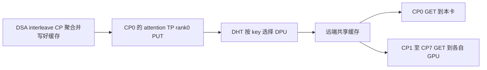
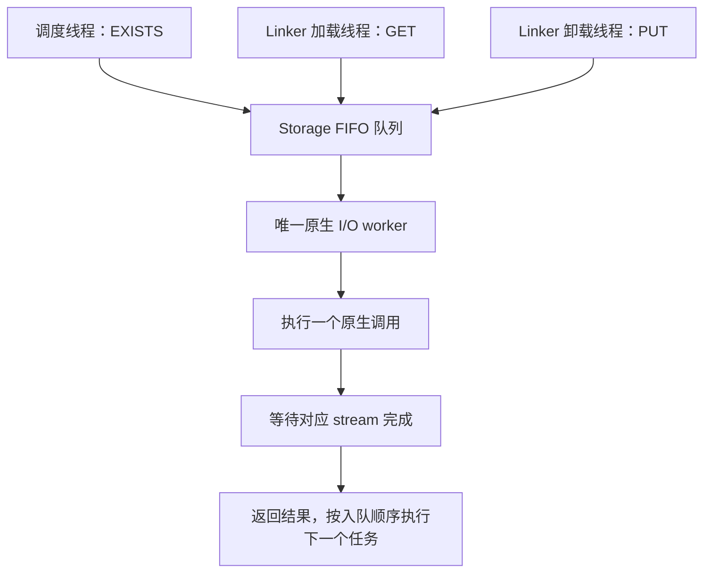

# OceanDisk：CP 共享缓存与 I/O 队列

更新：2026-10-30。本文描述当前工作区实现，重点是 **DSA interleave prefill CP、普通卸载、逐层加载**。

## 1. 使用范围

当前验证配置：

```bash
--enable-prefill-cp \
--cp-strategy interleave \
--attention-backend dsa \
--enable-unified-cache-external-linker \
--unified-cache-external-linker-backend oceandisk \
--hicache-storage-backend-extra-config '{"layerwise_save":false}'
```

`layerwise_save=false` 关闭计算过程中的逐层卸载。普通卸载仍在后台执行，GET 仍按层加载。

## 2. CP：只保存一份，各 rank 共享读取

此前，各 CP rank 使用不同的远端 key，各自保存一份。任意 rank 的连续命中前缀偏短，都会限制整组可恢复长度。

当前仅在以下条件全部满足时启用共享 CP 缓存：

- pool 标记为 `rank_replicated`；
- `attn_cp_size > 1`；
- `cp_strategy=interleave`；
- `attention_backend=dsa`。

此时：

1. 只有 **CP0 内的 attention TP rank0** 实际 PUT。用户当前 TP8／CP8 配置对应日志中的 `ATTN_CP0 TP0`。
2. 各 CP 的存储 namespace 都使用 `storage_cp_rank=0`，同一 UC page hash 编码成相同远端 key。
3. 各 rank 使用自己的 GPU 目标地址执行 GET，读取同一份远端数据。
4. 其他模式继续保留原有 CP key 隔离和写出 owner 规则。

共享 namespace 仍包含模型 namespace、page size、attention TP size、CP size、PP 信息等；并非删除全部并行身份。相同 page 的 KV 与 Indexer 使用相同整数 key，底层通过两种存储 namespace 区分。



按 DHT 写入四个 DPU 是分散存储：每个 key 选择一个归属 DPU，不是每个 key 复制四份。PUT、EXISTS、GET 必须路由到相同归属 DPU；同一 DPU 有多条等价连接时，conn 编号可以不同。

这参考旧 controller 的 MLA worker：`get_tensor_model_parallel_rank() != 0` 时跳过实际保存。共享的前提是各卡缓存内容和布局一致；interleave 的 KV／Indexer 聚合提供基础，用户最新真实 GPU 复测反馈见文末。

## 3. I/O 队列：集中调用，按顺序执行

每个 Storage 实例新增一个 `oceandisk-native-io` 后台线程和FIFO 队列，统一执行原生调用。

| 操作 | 调度单位 |
| --- | --- |
| EXISTS | 一次查询，包括 DEBUG 单 key 复查 |
| GET | 一层中的一个 metadata 批次 |
| 普通 PUT | 一个 metadata 批次的全部层 |

三种操作统一按入队顺序执行，没有操作优先级。普通 PUT 每个 metadata 批次一次提交全部层。



普通 PUT 的完整流程：

```text
UC 触发普通 offload
→ Linker 卸载线程等待源数据 ready
→ 准备全部层 metadata
→ 每次将一个批次的全部层交给 I/O worker
→ 该批全部层完成后，按 FIFO 调度下一项操作
→ 全部层、全部批次完成
→ 向 UC 返回本批卸载结果
```

GET 每层的所有批次完成后才通知该层可用，计算可以继续等待自己的层通知。EXISTS 调用方仍需等待查询结果；正在执行的原生调用无法被优先任务打断，排队的操作按 FIFO 等待。

## 4. 线程、stream 与完成结果

每个 rank 相关线程为推理／调度线程、Linker 加载线程、Linker 卸载线程，以及新增的 Storage 原生 I/O worker。

- GPU 计算使用计算 stream。
- GET、PUT 保留各自的 stream；原生 EXISTS 内部另有自己的 stream。
- 本 Storage 的原生调用由一个 worker 顺序执行，避免进程内交叠。
- 不同 GPU 进程仍能并发调用 GIDS；这是依赖各进程独立连接资源的正常工作方式。
- 队列取代了覆盖整批 PUT 的共享锁，但原生 I/O 仍顺序执行。

非 owner 可以先返回本地跳过结果；UC 原有逻辑跨 attention TP／CP 组汇总完成数量与成功状态，随后更新树节点、解除保护，不需要新增跨 rank 的后台线程 collective。

## 5. 与旧 controller 的对应和差异

| 项目 | 旧 controller 对应路径 | 当前适配 |
| --- | --- | --- |
| MLA 保存 | 全 TP rank0 实际保存 | DSA interleave 共享 CP 模式选 CP0／attention TP0 |
| CP 副本 | 直接使用 page hash 的共享存储思路 | 各 CP 使用相同的编码 key |
| 原生提交 | 公共队列中的 GET／PUT 由一个 worker 处理 | EXISTS／GET／PUT 都进入统一 worker |
| 调度顺序 | 公共队列按入队顺序 | 按入队顺序 |
| 普通 PUT | 可以一次原生调用提交多层 | 每批一次提交全部层，批次间允许其他操作进入 |

旧 controller 还有绕过公共 worker 的入口，因此这里只对照对应路径，不将其描述为所有操作完全串行。

## 6. 仍需验证的边界

1. 普通 PUT 已恢复每批一次提交全部层，同进程查询不会插入该批层间。完成 event 传入原生包装，由包装逐层记录；后台等待每批最后一层 event，再报告整批结果。不同进程仍可并发查询，当前未提供跨进程的整页发布屏障。
2. CUDA event／stream 完成不等于物理落盘。原生 PUT／GET 会等待远端应答，但持久化语义取决于 GIDS 协议；上层 `completed` 也不能替代完整的原生错误检查。
3. 用户最新 LLMTest 复测反馈：启用 CP0 单份保存、各 CP 共享 key 后，未再出现此前部分用户命中不足或不命中的现象。本次实测支持该改造有效；具体失败根因及更多负载下的稳定性仍未完全确认。
4. 新共享模式测试建议使用新 namespace，避免混用之前按 CP 分别保存的测试数据。

## 7. 测试日志

启动时各 rank 应显示：

```text
shared_cp_cache=True storage_cp_rank=0
```

仅指定写出 rank 显示 `owner=True`。同一请求各 rank 的 `first_hash` 和 `first_key` 应一致。

保留 `SGLANG_OCEANDISK_CACHE_DEBUG=1`、`SGLANG_OCEANDISK_TRACE=0` 可查看首次 miss probe：

- 查询 key、实际 conn 和 DPU endpoint；
- 本进程最近的普通 PUT 提交／完成记录及路由；
- 同 conn 的单 key 复查结果，复查不改变原始命中结果。

PUT 历史最多保留最近十万个 key；`put_record=None` 不足以单独证明漏存。`pending_offload_at_lookup` 是查询入口采样的本地全局任务数，不是当前 request 独有任务数。

## 8. 代码位置与验证状态

- `python/sglang/srt/mem_cache/storage/oceandisk/oceandisk_direct_linker.py`：CP owner、共享 namespace、Linker 完成队列。
- `python/sglang/srt/mem_cache/storage/oceandisk/oceandisk_storage.py`：FIFO 队列、原生 I/O worker、整批 PUT、逐层 GET、诊断日志。
- `python/sglang/srt/mem_cache/unified_radix_cache.py`：跨 attention 组汇总卸载完成与成功结果。
- 旧实现参考：`D:/a_storage/1_sglang/od/cache_controller.py`。

本地已通过队列行为模拟、CP owner／key 构造模拟、语法及静态检查。用户已完成一次真实 GPU／GIDS 的 LLMTest 复测，并反馈各用户命中恢复正常；当前结论基于用户测试反馈，尚未对该次完整日志逐项核验。
