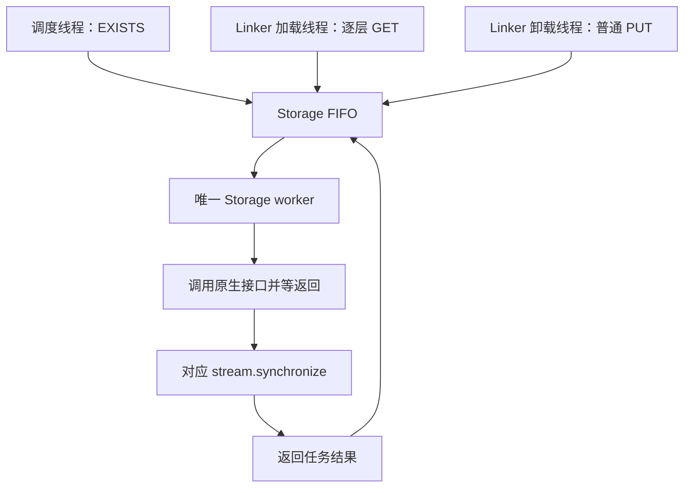

# OceanDisk EXISTS／GET／PUT 并发与同步分析

本文整理旧 cache controller 仓库 AI 提供的调用链分析、当前工作区实现及测试结论。重点是普通 PUT（`layerwise_save=false`）与 UC 逐层 GET。未修改 `D:/a_storage/1_sglang/od` 的原生实现。

## 1. 当前采用的实现

同一个 Scheduler／CP rank 进程内，同一个 OceanDiskStorage 实例的 EXISTS、GET、PUT 全部进入 Storage FIFO，由唯一 worker 执行：



- worker 同步完成前，不执行下一次队列中的原生调用。
- 不同 GPU／CP rank 的独立进程之间没有全局串行化。
- 一次整页卸载可能拆成多个原生批次；FIFO 不提供整页原子发布保证。
- GET 仍按层确认并通知 UC，不要求全部层加载完才开始计算。
- 原生包装记录的层完成 event 保留，用于 GET／PUT 完成确认。实验新增的 worker event 已删除。
- CUDA 工作完成不自动等于物理持久化落盘；写入可见性与源 buffer 可复用语义需要 GIDS 接口约定。

## 2. 用户实测与实验边界

| 实现变化 | 用户反馈 |
|---|---|
| EXISTS／GET／PUT 统一 FIFO，worker 内等 stream 完成 | 多 batch、多 round 的 LLMTest 命中符合预期 |
| worker 只等接口返回，删除额外 stream 同步 | 出现命中异常 |
| EXISTS 绕过公共队列直接调用 | 再次出现部分命中 |

这些是定位方向的重要证据，但不能单独证明具体哪一个原生变量发生竞争。多次修改之间涉及完成等待方式变化，需要避免把所有对照视为严格单变量实验。

目前恢复统一 FIFO＋stream 同步，作为有实测依据的基线。该反馈不等于完整 GPU 数据正确性或持久化语义已经得到证明。

## 3. 旧 controller 的调用与等待

本地参考文件：`D:/a_storage/1_sglang/od/cache_controller.py`、`nds_utils.py`、`pybind11.cpp`、`gids_kernel.cu`、`interface.txt`。

| 环节 | 已核对的本地代码行为 |
|---|---|
| EXISTS | `query_nds_cache()` 直接同步调用 `client.kv_exist()`，不走 `nds_operator_queue` |
| 公共队列 | 普通 FIFO，一个 `nds_operator_worker` 消费 GET／PUT 任务 |
| GET | 第 0 层有直接调用入口；剩余层可通过公共队列批量提交 |
| PUT | 有 worker 入口，也有 `start_writing()` 直接调用入口 |
| PUT 前等待 | worker 等 `operator.wait_event`，保证源 KV 准备好 |
| PUT 后 | 原生包装记录完成 event，再交给通知／ACK 等后续逻辑 |
| GET 使用前 | `wait_layerwise_data()` 取出对应层 event，配对检查后同步等待 |
| worker 操作后等待 | 没有统一的 `stream.synchronize()` 或统一完成 event 等待 |

### 单 worker 到底保证什么

```python
while True:
    operator = queue.get()
    native_call(...)
    # 函数返回后继续处理通知等代码，再回到下一轮 queue.get()
```

它保证 CPU 接口调用按顺序执行。是否同时保证上一笔 GPU I/O 完成，取决于原生接口返回语义；它不约束绕过队列的直接调用。

### 三类 event 不可混淆

| event | 含义 | 谁等待 |
|---|---|---|
| 源 ready event | attention 已将本层 KV 写好，允许开始 PUT | controller／Linker 卸载后台线程 |
| GET 完成 event | 本层读取完成，可以使用 | 加载完成逻辑／使用方 |
| PUT 完成 event | 对应写出 stream 到达完成点 | ACK／通知／Linker 完成处理 |

PUT 前的 ready event 不是 PUT 完成事件，更不是落盘事件。CPU 调用 `event.synchronize()` 阻塞的是调用它的线程，不能描述成“阻塞 attention stream 直到写出完成”。

## 4. 对方 AI 补充的外部仓库分析

以下是对方 AI 报告的内容。部分底层函数不在本地现有文件中，尚未独立逐行核验，不能全部视为本方已确认的代码证据。

### 4.1 调度与通知链

- overlap 调度允许新批次的 EXISTS 与上一批的 GET／PUT 在时间上交叠。
- attention backend 每层准备完成后，将 PUT 任务和 ready event 放入 controller 队列。
- PUT 后的通知最终将 `KVPutChunk` 放入 `transfer_queues`。
- transfer worker 等待传入的完成 event，再通知 decode 端；等待发生在 transfer worker，不反向阻塞 controller 的 I/O worker。

用户提供的 `add_layerwise_kvcache_request()` 确实只将层范围、页范围和 `wait_event` 入队，没有在正常路径同步等待。完整消费者实现仍来自对方分析。

这些调用入口说明代码允许交叠，不等于已用运行时间戳证明旧 controller 某次测试实际发生过交叠。

### 4.2 原生共享资源

对方报告：

1. 同一连接下，EXISTS 与 GET／PUT 可访问同一组 QP／RQ CQ。
2. 两个 RQ CQ 轮询函数先读取同一个 `cons_idx`，消费后再原子推进；未见互斥或原子预留各自消费区间。
3. EXISTS 命令固定写共享 send MR 偏移 0；GET／PUT 按 CID 分槽。
4. EXISTS 使用独立的非阻塞 `g_exist_stream`，仅同步这条内部 stream。
5. GET／PUT 内部执行设备同步后读取结果并返回。

最值得核验的是第 2 项：若两个消费者同时轮询同一个 CQ，它们可能取得相同消费起点。最后的 `atomicAdd` 不能补救前面未互斥的区间选择。

第 3 项要构成实际冲突，还需确认 GET／PUT 的活动槽位是否与偏移 0 区域重叠，以及命令缓冲的使用周期。

独立 stream 本身不是缺陷；当不同 stream 使用不支持并发的共享通信状态，且没有正确依赖时，才构成风险。

## 5. 当前 metadata 与旧实现的区别

| 操作 | 当前适配 |
|---|---|
| EXISTS | 每次创建一维 GPU tensor：`[task_id, keys..., connections...]` |
| GET | 每批创建独立 CPU／GPU 二维 metadata，按层切片提交 |
| 普通 PUT | 每批创建独立 CPU／GPU 二维 metadata，一次提交全部层 |

GET／PUT 每行对应一层，字段依次为 task_id、MR IDs、keys、HBM offsets、storage offsets、sizes、connections。各 IO 字段前半为 KV，后半为 Indexer；同一 page 的两者共享 key 和所选连接。长度按当前 legacy direct 方式向上补齐到 512 字节。

CPU／GPU metadata 引用保留到相关操作完成。三条路径不复用同一块输入 metadata，但会向原生接口传入同一个 `_output`，并使用同一套 GIDS 实例及连接状态。

旧 controller 同时存在预分配复用和新建 metadata 的入口，不能概括为“旧的全部复用、当前全部新建”。目前没有证据表明 metadata 分配方式是本次 bug 根因，不据此改动。

## 6. 必须纠正的推论

1. **独立输入缓冲不证明原生并发安全。** 通信队列、应答缓冲和计数器仍可能共享。
2. **EXISTS 对存储只读，不代表不修改通信状态。** 发命令、收应答和推进 CQ 都涉及状态变化。
3. **event 配对不是原生互斥锁。** 它检查层与事件对应，不能防止其他线程同时访问 CQ。
4. **ACK 不处理下一项，不等于 I/O worker 不提交下一项。** 两者可能是不同线程。
5. **pybind 调用同步函数时也要等函数返回。** 不能同时声称被调用的 GET／PUT 内部同步，又仅因为包装层记录 event，就认定整次接口只是异步下发。
6. **旧 controller 没有外层同步，不证明它不需要同步。** 实际库版本、入口和时序未完全对齐。
7. `gids_kernel.cu` 的 MR 初始化分支内同步，仅证明初始化等待；每次 GET／PUT 内部同步的证据在 `interface.txt` 对应 GIDS 函数中，且需确认部署库一致。

## 7. 当前结论及未解决问题

### 可以采用的结论

- 当前环境应保留统一 FIFO＋worker 内 stream 同步。
- EXISTS 绕队列后的异常，与共享 CQ 等原生并发风险方向一致。
- 不应为照搬旧代码而恢复未验证安全的直接调用入口。
- 逐层 GET 的 UC 通知机制继续保留；原生调用串行化不等于必须等全部层读完才计算。

### 仍不能下结论的部分

- 不能确认旧 controller 实测正常的具体原因，也不能保证它永远不会触发类似竞争。
- 不能仅凭现有摘要确认某个 CQ 竞争就是本次唯一根因。
- 若 GET／PUT 实际返回前已完成所有相关 GPU 工作，统一 FIFO 理论上应避免这些原生调用交叠。因此，“为什么只等接口返回仍异常，而额外 stream 同步正常”仍需解释，不能简单归因于 CQ 竞争。
- CUDA event／stream 完成是否保证跨进程 EXISTS／GET 可见，或保证源 GPU buffer 不再被访问，需要 GIDS 明确接口约定。

### 下一步最有价值的材料

1. 两个 RQ CQ 轮询函数完整实现、`find_qp()` 及 GET／PUT 线程参与条件，确认是否实际竞争同一 CQ。
2. 实际部署 `.so` 对应的 GET／PUT／EXISTS 实现与版本，核对返回语义和内部 stream 依赖。
3. 同一进程内原生调用进入、返回和完成边界的对照记录，区分推测与实际交叠。

在这些问题核实前，当前基线以用户实测正常的完成边界为准，不再用新增 worker event 替换，也不删除同步来追求表面上与旧 controller 一致。
